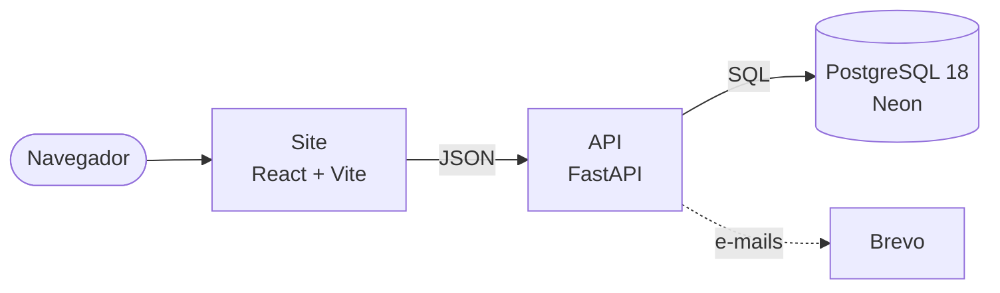
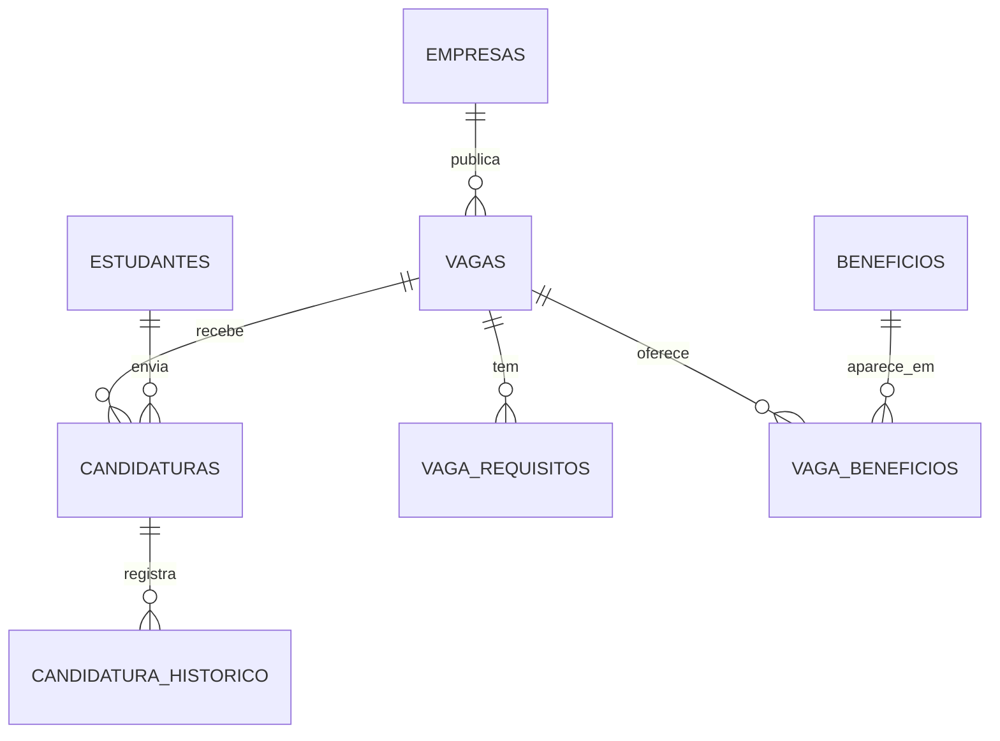

<h1 align="center">Emprega IF</h1>

<p align="center">
  <b>Estágios e vagas de jovem aprendiz para estudantes do Instituto Federal, num só lugar.</b><br>
  Projeto de extensão do IFMS
</p>

<p align="center">
  
  
  
  
  
</p>

<p align="center">
  <a href="https://emprega-if.onrender.com"><b>Acessar o site</b></a> ·
  <a href="#como-rodar">Como rodar</a> ·
  <a href="#banco-de-dados">Banco de dados</a> ·
  <a href="docs/DOCUMENTACAO-TECNICA.md">Documentação técnica</a>
</p>

<p align="center">
  
</p>

> O site está no plano gratuito do Render: no primeiro acesso, a API pode levar alguns segundos para acordar.

---

## Sobre

Para quem ainda está estudando, a primeira oportunidade é a mais difícil: as vagas ficam espalhadas e as plataformas grandes não são pensadas para iniciantes. O **Emprega IF** reúne vagas de **estágio** e de **jovem aprendiz** para estudantes do IF, e permite acompanhar cada etapa da candidatura.

## Funcionalidades

| Para estudantes | Para empresas |
|---|---|
| Cadastro simples, sem exigir experiência | Cadastro com CNPJ validado |
| Busca pelo nome da vaga, sem acento, com filtros | Publicação de vagas com prévia ao vivo |
| Candidatura com um clique | Painel com os candidatos de cada vaga |
| Linha do tempo de cada candidatura | Chamar para entrevista e finalizar |
| Avisos por e-mail | Encerrar ou cancelar vagas |

Para todos: login seguro, recuperação de senha por e-mail, e páginas de Termos de uso e Política de privacidade.

## Como funciona



| Camada | Tecnologia | Onde roda |
|---|---|---|
| Site | React 18, Vite, Tailwind CSS | Render (site estático) |
| API | Python 3.12, FastAPI, psycopg 3, JWT, bcrypt | Render |
| Banco de dados | PostgreSQL 18 | Neon |
| E-mails | Brevo (API HTTP) | — |

## Banco de dados

O banco tem **12 tabelas** e as regras mais importantes ficam **dentro dele**: valem para qualquer gravação, até para quem acessar direto pelo pgAdmin.



- **Normalizado (1FN):** requisitos, diferenciais e benefícios da vaga ficam em tabelas próprias, uma linha por item.
- **Integridade:** chaves estrangeiras, `UNIQUE` (CPF, CNPJ, e-mail, uma candidatura por vaga) e `CHECK` de formato.
- **4 triggers:** ciclo de vida da vaga, candidatura só em vaga aberta, status que só avança e histórico automático.
- **3 views:** vaga completa, painel da empresa e números da página inicial.
- **Busca textual:** Full Text Search em português com índice GIN, mais busca por trecho do título.
- **LGPD:** senhas só como hash bcrypt, CPF nunca mostrado às empresas e exclusão em cascata.

O banco é criado por **7 migrations** numeradas em [`backend/sql/migrations`](backend/sql/migrations), aplicadas sozinhas quando a API sobe:

| Migration | O que faz |
|---|---|
| `001` | Estrutura inicial: estudantes, empresas, vagas e candidaturas |
| `002` | Tabelas de domínio: setores e áreas |
| `003` | Primeira forma normal: requisitos, diferenciais e benefícios |
| `004` | Integridade: `CHECK`, `NOT NULL` e regras de exclusão |
| `005` | Triggers de regras de negócio e histórico de status |
| `006` | Views, busca textual e índices |
| `007` | Recuperação de senha (o banco guarda só o hash do código) |

## Como rodar

Com o [Docker Desktop](https://www.docker.com/products/docker-desktop/) instalado:

```bash
git clone https://github.com/BorgesJPBD/Emprega-IF.git
cd Emprega-IF
docker compose up
```

| Endereço | O que é |
|---|---|
| http://localhost:5173 | Site |
| http://localhost:8000/docs | Documentação interativa da API |
| `localhost:5432` | Banco (usuário e senha `postgres`) |

O banco já vem com empresas e vagas de exemplo. Para testar como empresa: `rh@techsolutions.exemplo.com`, senha `empresa123`.

> Se a porta 5432 já estiver em uso, crie um arquivo `.env` na raiz com `DB_PORTA=5433`.

## Estrutura

```
Emprega-IF/
├── backend/              API (FastAPI)
│   ├── app/routers/      uma rota por assunto: vagas, candidaturas, login...
│   └── sql/migrations/   o banco de dados, em scripts numerados
├── frontend/             site (React)
│   └── src/pages/        uma tela por arquivo
├── docs/                 documentação técnica e imagens
├── docker-compose.yml    sobe banco, API e site juntos
└── render.yaml           configuração da hospedagem
```

Mais detalhes (decisões técnicas, todas as rotas da API e o modelo de dados completo) estão na [documentação técnica](docs/DOCUMENTACAO-TECNICA.md).

## Equipe

Fernando Tinno Venceslau · Fernando Washington Silva · Fillype Oliveira Amorim · Gabriel Corrêa de Abreu Guanais · Hideki Wakui Oi · João Pedro Borges Dutra · João Victor Carrenho Alves · Matheus Costa Mendes

**Orientação:** Prof. Apio Carnielo e Silva

---

<p align="center">Projeto acadêmico de extensão do IFMS. Não é um serviço oficial do Instituto Federal.</p>
